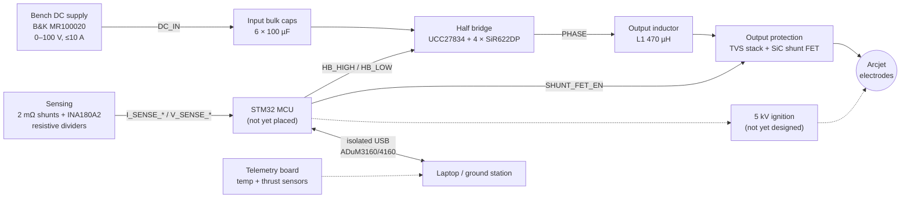

# Arcjet-PPU

**Power Processing Unit for a ~500 W argon arcjet thruster**
Rutgers University — Capstone Design Project, 2026

This repository holds the KiCad hardware design for the power processing unit (PPU) that drives our team's arcjet thruster. An arcjet heats propellant gas (argon, in our case) with a DC electric arc struck between a cathode and an anode nozzle, then expands the hot gas through the nozzle to produce thrust. The PPU's job is to strike that arc with a high-voltage pulse, then hold it steady by regulating current into a load that looks like a negative-resistance plasma.

> **Status:** Early schematic capture. The power stage, sensing and protection are partly drawn; the MCU, ignition circuit, auxiliary supplies and PCB layout have not been started yet. See [Design status](#design-status).

---

## Contents

- [Project overview](#project-overview)
- [System architecture](#system-architecture)
- [PPU requirements](#ppu-requirements)
- [Schematic walkthrough](#schematic-walkthrough)
- [Microcontroller pin budget](#microcontroller-pin-budget)
- [Parts so far](#parts-so-far)
- [Design status](#design-status)
- [Open questions](#open-questions)
- [Repository layout](#repository-layout)
- [Getting started](#getting-started)
- [References](#references)
- [Team](#team)

---

## Project overview

| | |
|---|---|
| Thruster type | DC arcjet (electrothermal) |
| Propellant | Argon |
| Target power | ~500 W |
| Bench power source | B&K Precision MR100020 DC supply |
| PPU input | 0–100 V DC, up to 10 A |
| PPU output | up to 100 V / 10 A sustained, 5 kV ignition pulse |
| EDA tool | KiCad 10 |
| Parts sourcing | LCSC preferred |

The full system has three pieces of electronics:

1. **This PPU board** — the half-bridge power stage, arc-ignition circuit, output protection and its own control MCU.
2. **A separate telemetry board** — reads the thruster's temperature and thrust sensors.
3. **The lab bench supply** — feeds the PPU's DC input.

## System architecture



**How the power stage works (as drawn so far):** the half bridge chops the DC input and the 470 µH inductor (L1) smooths that into a controlled current, which makes it a synchronous buck converter used as a current source. That matches what an arc needs. Once lit, an arc's voltage falls as its current rises, so the PPU must regulate *current*, not voltage. The NASA 1991 low-power arcjet PPU (see [References](#references)) used the same idea: a switching bridge, current-mode PWM control and an output current-averaging inductor.

## PPU requirements

From `Notes.txt`:

**Power**

| Parameter | Value |
|---|---|
| Input voltage | 0–100 V |
| Input current | up to 10 A |
| Total power | 500 W |
| Output voltage (sustained) | up to 100 V |
| Output current (sustained) | up to 10 A |
| Ignition voltage | 5 kV |

**Connectors:** DC input · electrode output · isolated USB · Cortex debug (SWD)

**Telemetry readings**

- Input voltage
- Input current *(maybe)*
- Output voltage
- Output current
- Half-bridge duty cycle
- Board temperature *(maybe several zones)*
- Fault conditions
- Arc-start detection

**Faults to detect**

- Overtemperature
- Input overcurrent
- Output overcurrent
- Ignition failure
- TVS activated
- Output voltage collapse (short circuit)

## Schematic walkthrough

The design is a hierarchical schematic with three files:

```
Arcjet-PPU.kicad_sch          (root sheet)
├── Half Bridge               → Half_Bridge.kicad_sch
└── Gate Resistors ×4         → Gate_Resistors.kicad_sch  (one instance per FET)
```

### Root sheet — `Arcjet-PPU.kicad_sch`

## References

1. L. E. Wallner and J. Czika, Jr., *Arc-Jet Thrustor for Space Propulsion*, NASA TN D-2868, Lewis Research Center, June 1965. A review of early arcjet research: thruster geometry, propellants and performance.
2. J. A. Hamley and G. M. Hill, *Power Electronics for Low Power Arcjets*, NASA TM-104459 / AIAA-91-1991, 27th Joint Propulsion Conference, 1991. A 100–400 W arcjet PPU with a four-transistor bridge, current-mode PWM, an output current-averaging inductor with an integral pulse-generation winding for starting, an open-circuit voltage above 175 V, and efficiency above 92.5%. **This is the closest reference design to our PPU.**
3. Texas Instruments, UCC27834 and UCC27511 datasheets.
4. Texas Instruments, INA180 datasheet.
5. Wolfspeed, C3M0900170D datasheet.
6. Analog Devices, ADuM3160 / ADuM4160 datasheets.

## Team

Rutgers University — Capstone 2026

| Name | Role |
|---|---|
| _TBD_ | |
| _TBD_ | |
| _TBD_ | |

**Faculty advisor:** _TBD_

---

> ⚠️ **Safety:** this board handles up to 100 V / 10 A continuously and a 5 kV ignition pulse. Never work on it while it is powered. Discharge the bulk capacitors before handling. Run ignition tests only behind a shield, with the vacuum chamber and gas system interlocked.
